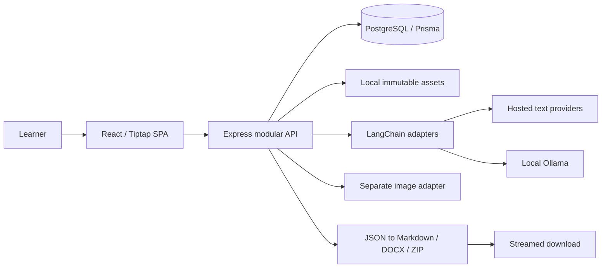
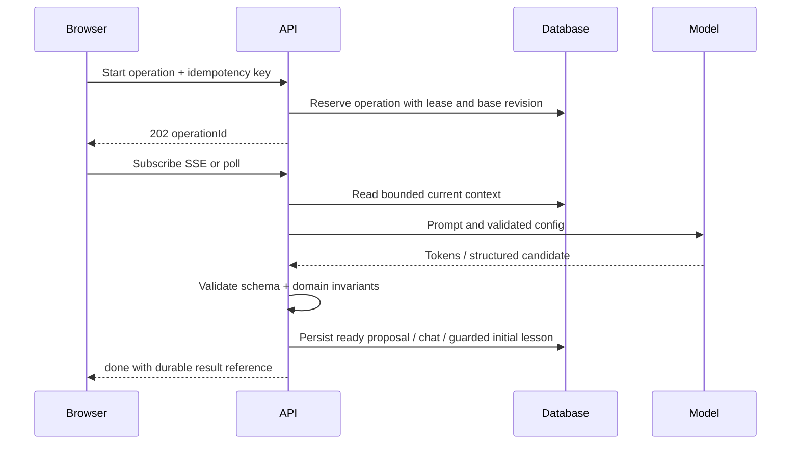

# System architecture

Proposed baseline, 2026-10-18. See [decisions](adr/0001-mvp-architecture.md). This document describes intended behavior, not existing code.

## Runtime and package boundaries

One browser SPA, one Express process, one PostgreSQL database, and local asset storage. Hosted providers and Ollama are external dependencies. Docker Compose initially runs PostgreSQL only; development runs Node on the host. Production/local distribution serves built SPA and `/api/v1` from the same loopback origin. Vite proxies `/api` in development. No workers, broker, authentication, Redis, or LangGraph.



| Boundary | Owns | Must not do |
|---|---|---|
| `apps/web` | Routing, accessible shell, Tiptap transactions, autosave queue, previews, fetch/SSE | Import Prisma, provider SDKs, secrets, or filesystem code |
| `apps/api` | HTTP, authorization of local origin, DB transactions, operation lifecycle, context reads, file lifecycle | Put model calls inside DB transactions or maintain a divergent editor transformation algorithm |
| `packages/shared` | Zod wire contracts, headless ProseMirror schema and pure fragment transformations, document version, enums, typed errors | Import server libraries, DOM-only editor UI or read environment |
| `packages/ai` | Factory, capability registry, prompts, bounded runnables, structured validation, provider error mapping | Access DB/files, choose document offsets, or apply edits |
| `packages/document-export` | Pure JSON traversal, Markdown/DOCX conversion, manifest, ZIP assembly through supplied asset resolver | Call AI or read arbitrary filesystem paths |
| `prisma` | Schema and reviewed SQL migrations/invariants | Treat generated client as the domain layer |

API modules: courses/syllabus; topics/prerequisites; lessons/versions; edits; chat; providers; assets; exports; progress. Each has router, service, repository boundary and shared request/response contracts. Services coordinate transactions; repositories scope reads to course/lesson IDs. UI features mirror these modules. Reuse common errors and contracts, not a generic mega-service.

Planned remaining files: `tests/fixtures`, `tests/integration`, `tests/e2e`, `data/assets`, ignored `data/tmp`, `docker-compose.yml`, `.env.example`, README, CONTRIBUTING, LICENSE. Select and document the open-source license before release; no license choice is implied by this plan. Do not create these runtime artifacts in the planning milestone.

## Source of truth and invariants

1. `Lesson.document` is canonical Tiptap JSONB. Markdown and DOCX are derived exports only. `DocumentVersion` is an intentional recovery snapshot, not a second editable representation.
2. One lesson belongs to one leaf topic. Arbitrary hierarchy uses adjacency lists; traversals have resource caps rather than a fixed module/topic depth. Explicit wrap creates a new container above the original leaf, retaining leaf ID/lesson/chat/progress; it does not reassign the existing lesson to another topic ID.
3. Lesson revisions are monotonic integers. Any content mutation uses compare-and-swap (CAS), adds the replaced state to history, and updates asset references in one transaction. Restore and regeneration are mutations too.
4. Model settings do not own or cascade-delete courses, documents, or chat. Operations snapshot nonsecret configuration so changing the default cannot alter a running request.
5. AI outputs are proposals until validation and an explicit commit path. No partial streamed lesson is saved as the canonical document.
6. External AI calls happen outside DB transactions. Duplicate generation is controlled by a PostgreSQL unique active-operation constraint and a lease, not an in-memory mutex.

## Save flow

```mermaid
sequenceDiagram
  participant E as Editor
  participant A as API
  participant D as PostgreSQL
  E->>A: PUT lesson (baseRevision, mutationId, JSON)
  A->>D: Transaction: dedupe mutation; CAS revision
  alt matching revision
    A->>D: Snapshot old JSON + assets; update JSON + refs
    D-->>A: Commit new revision
    A-->>E: Saved revision and mutationId
  else conflict
    D-->>A: No update
    A-->>E: 409 currentRevision
    Note over E: Retain local JSON; fetch remote separately
  end
```

See [editor design](EDITOR_DESIGN.md) for queue behavior. Browser recovery drafts are best-effort IndexedDB copies with base revision, not a replacement database. Never include credentials. Crash recovery compares the draft base with server revision before offering restore; a newer local draft never silently overwrites saved data.

## AI operation flow



Operation kinds: syllabus draft, initial lesson, regeneration proposal, edit proposal, chat, image. Pending/running/ready/applied/rejected/failed/cancelled/interrupted/expired are durable states. Ready is terminal for provider work; proposal acceptance can transition ready to applied/rejected, or cleanup transitions it to expired after 7 days. Chat and initial lesson transition directly to applied after persistence. SSE disconnect does not silently rerun a provider request. Explicit cancellation aborts upstream best effort; commit checks cancellation and lease token. Startup marks expired active leases interrupted; retry is explicit. A heartbeat extends a lease; owner-token guarded finalization prevents an old process from committing after takeover.

Use database kind values `syllabus`, `initial_lesson`, `regeneration`, `edit`, `chat`, `image` consistently. Edits/syllabus/regeneration finish provider work with ready; explicit document/tree commit marks applied. Image provider work persists a ready asset proposal; explicit insertion autosave marks the image operation applied only when that asset is referenced by the saved lesson (otherwise it remains ready until rejected/expired). Terminal SSE ready closes the proposal-generation stream; a later acceptance is observed through its HTTP response/polling. Chat and initial lessons emit done after saved persistence. No acceptance-claim endpoint: final ready-operation check, lesson CAS and targeted transformation validation are one save transaction. Lock order is course, lesson, operation; rejection/cancellation use the same order when attached to a lesson.

## Local security boundary

Bind API to `127.0.0.1` by default; support explicit IPv6 loopback configuration. Validate Host and Origin, reject unknown cross-origin and cross-site mutation requests, require JSON for JSON writes, and use an origin-checked custom header on multipart/other mutations. Development allowlist is exact configured Vite origin. Do not use wildcard CORS. Local-only is not an authentication boundary against other local processes; remote/multiuser hosting is unsupported.

Environment keys are preferred. UI keys are write-only, session-memory secrets behind opaque random handles and TTL; process restart requires reentry. Session handles never appear in exports. No persistent key vault in initial MVP. No keys in `VITE_*`. Provider base URLs are fixed for hosted adapters; Ollama defaults to loopback port 11434 and rejects non-loopback overrides in MVP to reduce SSRF. Provider redirects must not bypass that restriction.

UI entry necessarily places a key briefly in the password field and local request body; “server-side credentials” means no persistent browser storage, application-state cache, GET response, log, or bundle exposure. Clear the field immediately after submission; never copy it into query/cache/devtools persistence. Host-only local traffic and the OS account are the trust boundary, not protection against a malicious local process. Session binding, TTL and active-call behavior are specified in DATABASE.md. Keep normal development requests behind the Vite proxy; do not weaken origin validation for convenience.

Uploads accept bounded decoded PNG/JPEG/WebP, not SVG/HTML. Random internal filenames, root-contained paths, no executable permissions, restrictive file permissions where available, no MIME sniffing. Render notes through a restricted Tiptap schema; no raw HTML/scripts; link protocols allowlisted. Asset downloads use IDs and DB records, never client paths. Browser CSP limits scripts/images/connect origins; uploads cannot become active HTML.

Prompt injection is mitigated, not solved: notes/chat are delimited untrusted context; models receive no filesystem, network, or mutation tools. User edits never acquire system instruction priority. External model content is untrusted and validated. Default logging includes request/operation IDs, status, duration, model identity, and token counts only. Disable hosted tracing by default; redact errors before logging or returning them.

## Export and recovery data flows

Export reads a consistent short repeatable-read snapshot of course structure, saved lesson revisions, and asset metadata; releases the transaction before file conversion. Immutable files remain protected by an export lease/asset pin until streaming completes. Never hold a DB transaction open while streaming. Errors before headers return JSON; errors after headers terminate the stream, delete temporary files, and are recorded under a request ID. Browser flushes active edits before requesting an export.

Logical course deletion cascades DB learning records; assets are reclaimed separately after no live/version/export reference remains. Local assets and PostgreSQL must be backed up together. ZIP exports are portable learning documents, not complete backups. Future backup manifest includes document schema version, tree, revisions, assets and checksums, excludes keys, and requires a validated import migration.

## Operational verification

`GET /health/live` checks process; `/health/ready` checks DB, migration compatibility, and writable asset root, not a paid model call. Limit JSON bytes, upload bytes, document nodes, tree size, context tokens, operation concurrency, and request time. Proposed defaults live in API design; calibrate with representative fixtures. Use a single cleanup loop inside the monolith for leases/temp files. CI uses a real PostgreSQL service, fake deterministic model adapters, unit tests, integration tests, production build, and Playwright. Live provider smoke checks remain opt-in. Sources and technology tradeoffs are recorded in the ADR.
