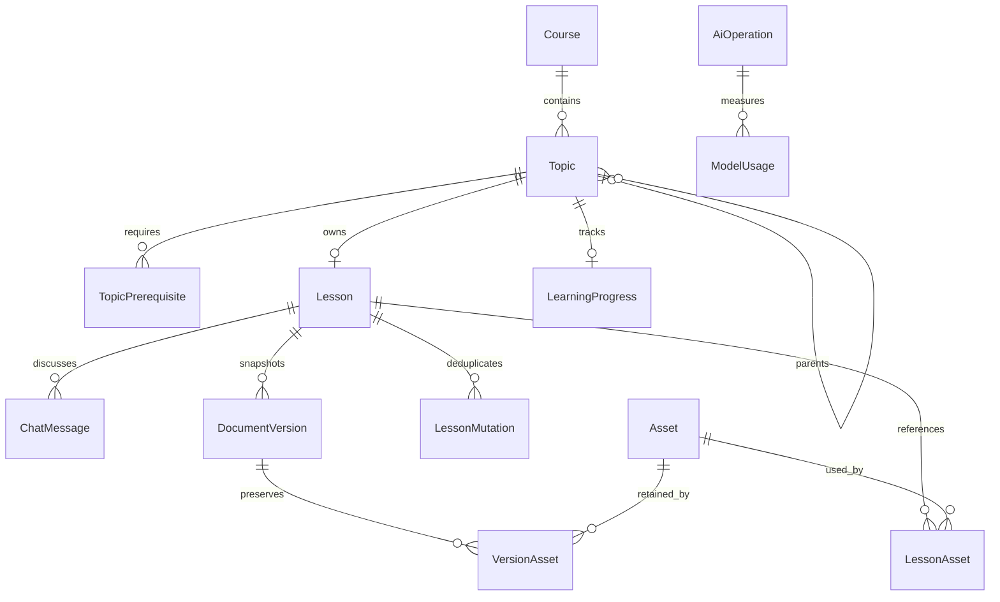

# PostgreSQL and Prisma design

Proposed logical schema. No migrations or application schema are installed in this milestone. PostgreSQL is the source of truth; `lessons.document` is JSONB. Prisma proposal below uses logical camelCase fields with snake_case table mappings. Add field-level `@map` consistently in implementation if adopting snake_case columns; SQL migrations must use the chosen physical names.

## Relationships



One learner/workspace, no user table. `Course.preferences` is a validated teaching-preference snapshot; `WorkspaceSettings` supplies defaults. Topic `kind` is module/topic/subtopic for display only; leaf status is computed from children. Dependencies and parent hierarchy are separate DAGs. Prerequisite selection is per edge, allowing the same concept to be studied for one dependency and skipped for another.

## Prisma proposal

This is a reviewable schema proposal, not generated executable application code. Connection configuration and generator settings must follow the pinned Prisma major selected during scaffold. Scalar references explicitly noted below require migration foreign keys where Prisma relation fields are omitted; they must not be left unenforced.

```prisma
model Course {
  id String @id @default(uuid()) @db.Uuid
  title String @db.VarChar(240)
  goal String @db.Text
  preferences Json @db.JsonB
  treeRevision Int @default(0)
  createdAt DateTime @default(now())
  updatedAt DateTime @updatedAt
  topics Topic[]
  assets Asset[]
  @@map("courses")
}

model Topic {
  id String @id @default(uuid()) @db.Uuid
  courseId String @db.Uuid
  parentId String? @db.Uuid
  title String @db.VarChar(240)
  kind String @db.VarChar(20)
  position Int
  objectives Json @db.JsonB
  course Course @relation(fields:[courseId], references:[id], onDelete:Cascade)
  parent Topic? @relation("Tree", fields:[parentId], references:[id], onDelete:Cascade)
  children Topic[] @relation("Tree")
  lesson Lesson?
  progress LearningProgress?
  dependencies TopicPrerequisite[] @relation("Dependent")
  requiredBy TopicPrerequisite[] @relation("Required")
  @@unique([id, courseId])
  @@index([courseId, parentId, position])
  @@map("topics")
}

model TopicPrerequisite {
  topicId String @db.Uuid
  prerequisiteId String @db.Uuid
  courseId String @db.Uuid
  choice String @default("undecided") @db.VarChar(20)
  topic Topic @relation("Dependent", fields:[topicId], references:[id], onDelete:Cascade)
  prerequisite Topic @relation("Required", fields:[prerequisiteId], references:[id], onDelete:Cascade)
  @@id([topicId, prerequisiteId])
  @@index([prerequisiteId])
  @@map("topic_prerequisites")
}

model Lesson {
  id String @id @default(uuid()) @db.Uuid
  topicId String @unique @db.Uuid
  document Json @db.JsonB
  documentSchemaVersion Int @default(1)
  revision Int @default(1)
  contentHash String @db.VarChar(64)
  source String @default("manual") @db.VarChar(30)
  operationId String? @db.Uuid
  restoredFromRevision Int?
  createdAt DateTime @default(now())
  updatedAt DateTime @updatedAt
  topic Topic @relation(fields:[topicId], references:[id], onDelete:Cascade)
  versions DocumentVersion[]
  messages ChatMessage[]
  assets LessonAsset[]
  mutations LessonMutation[]
  @@map("lessons")
}

model DocumentVersion {
  id String @id @default(uuid()) @db.Uuid
  lessonId String @db.Uuid
  revision Int
  document Json @db.JsonB
  documentSchemaVersion Int
  contentHash String @db.VarChar(64)
  source String @db.VarChar(30)
  operationId String? @db.Uuid
  restoredFromRevision Int?
  createdAt DateTime @default(now())
  lesson Lesson @relation(fields:[lessonId], references:[id], onDelete:Cascade)
  assets VersionAsset[]
  @@unique([lessonId, revision])
  @@index([lessonId, createdAt])
  @@map("document_versions")
}

model LessonMutation {
  lessonId String @db.Uuid
  mutationId String @db.Uuid
  requestHash String @db.VarChar(64)
  resultingRevision Int
  resultingUpdatedAt DateTime
  resultingContentHash String @db.VarChar(64)
  createdAt DateTime @default(now())
  lesson Lesson @relation(fields:[lessonId], references:[id], onDelete:Cascade)
  @@id([lessonId, mutationId])
  @@map("lesson_mutations")
}

model ChatMessage {
  id String @id @default(uuid()) @db.Uuid
  lessonId String @db.Uuid
  role String @db.VarChar(16)
  content String @db.Text
  sequence Int
  turnId String @db.Uuid
  operationId String? @db.Uuid
  status String @db.VarChar(20)
  contextRevision Int?
  createdAt DateTime @default(now())
  lesson Lesson @relation(fields:[lessonId], references:[id], onDelete:Cascade)
  @@unique([lessonId, sequence])
  @@unique([turnId, role])
  @@index([lessonId, createdAt])
  @@map("chat_messages")
}

model LearningProgress {
  topicId String @id @db.Uuid
  status String @default("not_started") @db.VarChar(20)
  completedAt DateTime?
  updatedAt DateTime @updatedAt
  topic Topic @relation(fields:[topicId], references:[id], onDelete:Cascade)
  @@map("learning_progress")
}

model Asset {
  id String @id @default(uuid()) @db.Uuid
  courseId String @db.Uuid
  storageKey String @unique @db.VarChar(200)
  originalName String @db.VarChar(240)
  mimeType String @db.VarChar(80)
  bytes Int
  width Int
  height Int
  sha256 String @db.VarChar(64)
  source String @db.VarChar(20)
  state String @db.VarChar(20)
  createdAt DateTime @default(now())
  course Course @relation(fields:[courseId], references:[id], onDelete:Cascade)
  lessons LessonAsset[]
  versions VersionAsset[]
  exports ExportAsset[]
  @@index([courseId, state])
  @@map("assets")
}

model LessonAsset {
  lessonId String @db.Uuid
  assetId String @db.Uuid
  lesson Lesson @relation(fields:[lessonId], references:[id], onDelete:Cascade)
  asset Asset @relation(fields:[assetId], references:[id], onDelete:Restrict)
  @@id([lessonId, assetId])
  @@index([assetId])
  @@map("lesson_assets")
}

model VersionAsset {
  versionId String @db.Uuid
  assetId String @db.Uuid
  version DocumentVersion @relation(fields:[versionId], references:[id], onDelete:Cascade)
  asset Asset @relation(fields:[assetId], references:[id], onDelete:Restrict)
  @@id([versionId, assetId])
  @@index([assetId])
  @@map("version_assets")
}

model AiOperation {
  id String @id @default(uuid()) @db.Uuid
  courseId String? @db.Uuid
  topicId String? @db.Uuid
  lessonId String? @db.Uuid
  providerConfigId String? @db.Uuid
  kind String @db.VarChar(30)
  status String @db.VarChar(20)
  scopeKey String @db.VarChar(200)
  idempotencyKey String @db.Uuid
  requestHash String @db.VarChar(64)
  baseRevision Int?
  baseTreeRevision Int?
  retryOfOperationId String? @db.Uuid
  target Json? @db.JsonB
  contextManifest Json? @db.JsonB
  result Json? @db.JsonB
  modelSnapshot Json @db.JsonB
  promptVersion String @db.VarChar(40)
  ownerToken String? @db.Uuid
  leaseUntil DateTime?
  errorCode String? @db.VarChar(60)
  createdAt DateTime @default(now())
  updatedAt DateTime @updatedAt
  usage ModelUsage[]
  @@unique([scopeKey, idempotencyKey])
  @@index([status, leaseUntil])
  @@index([lessonId, createdAt])
  @@map("ai_operations")
}

model AiProviderConfiguration {
  id String @id @default(uuid()) @db.Uuid
  purpose String @db.VarChar(16)
  provider String @db.VarChar(30)
  modelId String @db.VarChar(160)
  options Json @db.JsonB
  credentialSource String @db.VarChar(16)
  credentialEnvName String? @db.VarChar(80)
  capabilities Json @db.JsonB
  registryVersion String @db.VarChar(40)
  revision Int @default(1)
  updatedAt DateTime @updatedAt
  @@map("ai_provider_configurations")
}

model WorkspaceSettings {
  id Int @id @default(1)
  preferences Json @db.JsonB
  textConfigId String? @db.Uuid
  imageConfigId String? @db.Uuid
  @@map("workspace_settings")
}

model ModelUsage {
  id String @id @default(uuid()) @db.Uuid
  operationId String @db.Uuid
  provider String @db.VarChar(30)
  modelId String @db.VarChar(160)
  attempt Int
  inputTokens Int?
  outputTokens Int?
  estimated Boolean @default(false)
  durationMs Int
  outcome String @db.VarChar(20)
  createdAt DateTime @default(now())
  operation AiOperation @relation(fields:[operationId], references:[id], onDelete:Cascade)
  @@unique([operationId, attempt])
  @@map("model_usage")
}

model ExportLease {
  id String @id @default(uuid()) @db.Uuid
  courseId String @unique @db.Uuid
  ownerToken String @db.Uuid
  expiresAt DateTime
  assets ExportAsset[]
  @@index([expiresAt])
  @@map("export_leases")
}

model ExportAsset {
  leaseId String @db.Uuid
  assetId String @db.Uuid
  lease ExportLease @relation(fields:[leaseId], references:[id], onDelete:Cascade)
  asset Asset @relation(fields:[assetId], references:[id], onDelete:Restrict)
  @@id([leaseId, assetId])
  @@index([assetId])
  @@map("export_assets")
}
```

## Mandatory migration constraints beyond the proposal

- Add foreign keys for `AiOperation.courseId/topicId/lessonId` with cascade on owner deletion; validate all supplied scopes agree. `providerConfigId` and workspace config IDs reference provider configurations with SET NULL; historical `modelSnapshot` survives config deletion. Lesson/version/message operation references and retryOfOperationId use SET NULL. ExportLease.courseId references Course with RESTRICT so an export cannot lose its owning metadata midstream. Add Prisma relation fields/opposite fields for scalar FKs before migration generation. The proposal intentionally lists these additions here; it is not ready to copy directly into a Prisma migration.
- Enforce same-course parent and dependency references with composite FKs `(parentId,courseId) -> topics(id,courseId)` and analogous dependency FKs. Course ID on dependencies is deliberate constraint-supporting duplication.
- Two partial unique indexes enforce sibling positions: `(courseId,parentId,position) WHERE parentId IS NOT NULL` and `(courseId,position) WHERE parentId IS NULL`; a nullable composite unique alone is insufficient. Reordering temporarily moves affected positions to a collision-free high range, then assigns final dense order in one locked transaction.
- `position >= 0`, `revision >= 1`, `treeRevision >= 0`, nonnegative token counts/bytes, role/status/kind/provider/purpose allowlists, workspace singleton `id=1`, and no self-parent/self-prerequisite CHECKs. `document` root must be a JSON object with `type=doc`; complete schema validation remains application-side.
- A partial unique index on `AiOperation.scopeKey` WHERE status IN (pending,running) AND kind IN (initial_lesson,chat) guarantees one active initial-generation operation per topic and one chat turn per lesson. Stable scopes are `<kind>:<ownerId>`, including `initial_lesson:<topicId>`, `chat:<lessonId>`, and `edit:<lessonId>`. All operation kinds deduplicate by scope+idempotencyKey, but independent edit proposals are allowed concurrently. Apply is guarded by unique lesson topic ID and revision CAS as well.
- Cycle checks use recursive CTEs under a course-row lock. All structural writes lock that course, compare treeRevision, validate parents/dependencies, then increment treeRevision. Do not rely on an unlocked pre-check. Lesson creation locks the same course before checking leaf status, avoiding a leaf-generation/add-child race. Triggers reject parent/dependency cycles for non-API writes if adding direct DB tools later; until then migrations and API are the only supported writers.
- Assets in documents and versions must belong to the same course. Reference synchronization occurs in the content transaction; do not accept arbitrary storage keys in document JSON. ExportLease/ExportAsset above protect files during export. Acquire a per-course lease under course lock before taking the repeatable-read snapshot; all GC/deletion paths use the same course lock. Heartbeat the lease while streaming; stop the stream before releasing it. Another live process may reclaim only after expiry plus grace exceeding the stream deadline; single-process startup can reclaim leases from the prior process after its streams have ended. Ready image proposals also pin their result asset through an operation-result lookup until insertion/rejection/expiry, so an unused preview cannot be deleted prematurely.

## Transaction recipes

**Save:** validate/hash document outside transaction; begin; lock course then lesson then operation (when applicable) in that order; check dedupe receipt first; verify expected revision and ready AI proposal if present; reconstruct/verify targeted transformation; insert old revision snapshot and version asset refs; conditional update `WHERE id=? AND revision=?`; increment revision; replace current asset refs; insert mutation receipt; mark operation applied when applicable; commit. Return 409 if CAS affected zero rows. Receipt stores original revision, updatedAt and contentHash so a lost response is replayed accurately even if lesson advanced. No-op identical hash returns current revision with receipt and no duplicate snapshot. Manual creation stores a receipt in the same transaction as revision 1; topic uniqueness protects competing creation.

Current Lesson.source/operationId/restoredFromRevision describe the mutation that produced its current content. Snapshot copies those fields and the original updatedAt into DocumentVersion.createdAt; do not label the old revision with the new mutation's provenance. Save then sets new provenance on Lesson. Sources are manual/initial_ai/ai_edit/regenerate/restore; initial creation has no prior snapshot.

**Generation:** reserve leased operation and baseTreeRevision in transaction; capture immutable context; external model call; validate; finalize under course lock plus operation owner/status check; confirm treeRevision unchanged, topic still exists/is leaf and no lesson exists; insert revision 1 and references. Existing lesson always wins. Any changed course metadata/tree invalidates initial generation conservatively. Regeneration creates a ready proposal; explicit commit checks baseRevision and baseTreeRevision, then snapshots/replaces. Syllabus commit checks ready operation and baseTreeRevision and records applied result/draft hash atomically for retry. No lesson row with partial or null document represents generation state.

**Restore:** validate selected version, resolve assets, then use the same save transaction with source restore. Restoration creates a new revision, never rewinds version numbering. Concurrent changes result in 409.

**Tree mutation:** lock course, check treeRevision, validate DAG/leaf invariants, mutate and reorder siblings, increment once. Moving subtree preserves IDs/lessons; deleting subtree requires confirmation with exact treeRevision. A leaf with lesson cannot gain children implicitly; explicit wrap action moves the topic's lesson/progress/chat identity by retaining the original topic as a new child and introducing a container.

**Chat:** serialize one active turn per lesson; persist user turn before calling model, assign sequence under lesson lock; completed assistant plus usage finalization are atomic. Interrupted assistant content is not stored as a completed message. Retry reuses existing user turn or explicitly starts a new turn, preventing duplicate user messages.

**Preferences/progress:** workspace preferences are defaults copied on course creation; updating workspace defaults does not rewrite existing course preferences. Course goal/preferences/topic objective edits increment treeRevision. Dependency choice updates also increment treeRevision under course lock; API returns the new value even when the request has no baseTreeRevision (choice is a small last-intent-wins scalar). Only leaves receive explicit progress records; missing record means not_started. Containers derive counts; leaf-to-container wrap retains original progress on the retained leaf. Reject setting container completion directly. Text/image config defaults must reference the matching purpose.

## Retention and failure behavior

Snapshots retained indefinitely initially; count/size shown later. Operations retain proposals needed for review; consumed large initial-generation result is replaced by durable lesson reference to avoid duplicating every document. Rejected/expired proposal payloads can be cleared after 7 days; keep nonsecret metadata. Mutation receipts remain for lesson lifetime. Usage has no prompts or credentials. All keys stay in environment/session memory; config `options` is an allowlisted nonsecret object, not a credential bucket.

File write: stage under temp, decode/validate, atomic rename into immutable asset store, then mark DB asset ready. Cleanup reconciles staged/orphaned files after a grace period; DB rollback can orphan a file but must not leave a ready record pointing at missing content. Deleting DB records schedules safe file GC rather than deleting files during a transaction. Retain assets referenced by history, ready proposals and active exports. Course deletion returns EXPORT_IN_PROGRESS while a live lease exists; expired leases are cleaned safely before deletion. Once deletion succeeds, cascade DB content/references first, then asset rows, then reconcile unreferenced immutable files; verify FK deletion order explicitly because RESTRICT references must not be left for an ambiguous cascade order.

Credential session map is keyed internally by config ID + config revision, with opaque secret handles held only in server memory. Persist credentialSource=session but no handle/key. On expiry/restart configured=false. Provider PUT uses revision CAS and increments revision; changing a key/model never mutates old model snapshots. Resolve the effective adapter/secret reference at operation start; retain it only until completion/deadline, including when the config is edited/deleted meanwhile. Session TTL is 8 hours for new work; active bounded calls may finish. Global defaults are independent of course data.

For imageOperationId saves, validate same-course ready image result and its referenced asset instead of a text-range transformation; atomically apply the image operation and update refs/provenance. `contextManifest` records IDs/revisions/block IDs and omission flags, never credentials or raw prompts. Proposal expiration transitions ready to expired after 7 days, releases proposal asset protection, and makes acceptance return 409 OPERATION_EXPIRED. Cleared payloads remain unavailable rather than triggering implicit regeneration.

## Verification and sources

Use real PostgreSQL integration tests for partial indexes, NULL parent ordering, cycle races, cross-course references, duplicate generation, save receipts, rollback, restore, deletion cascades, and file/DB reconciliation. `prisma validate`, migration-from-empty and upgrade tests are required during implementation; this Markdown proposal has not been Prisma-validated. [Prisma transactions](https://www.prisma.io/docs/orm/v7/prisma-client/queries/transactions) and [client concurrency guidance](https://docs.prisma.io/docs/orm/v6/reference/prisma-client-reference) support version-based concurrency; the project must pin a compatible major rather than mixing their APIs.
